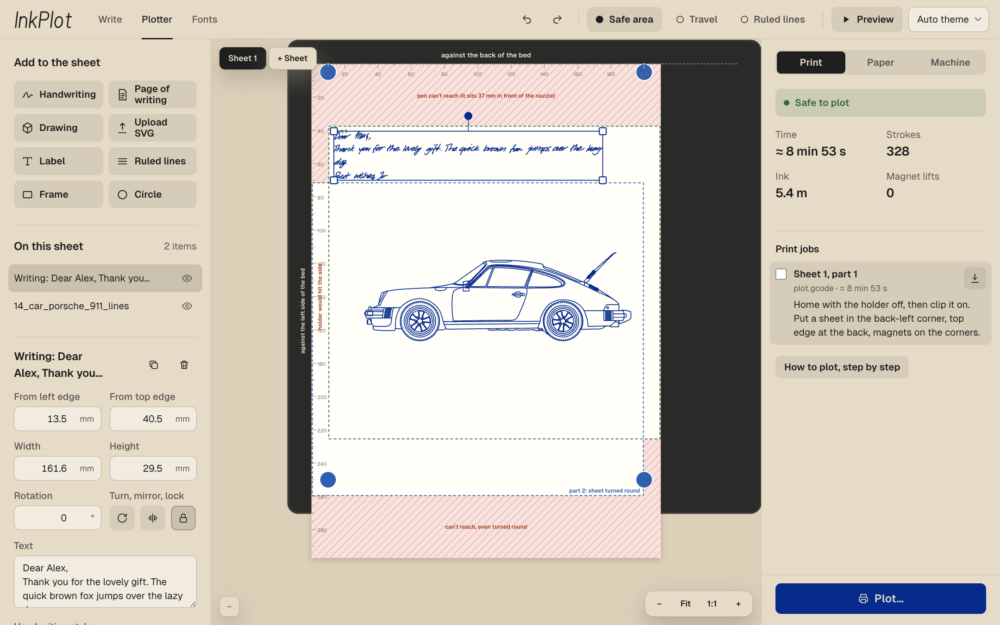
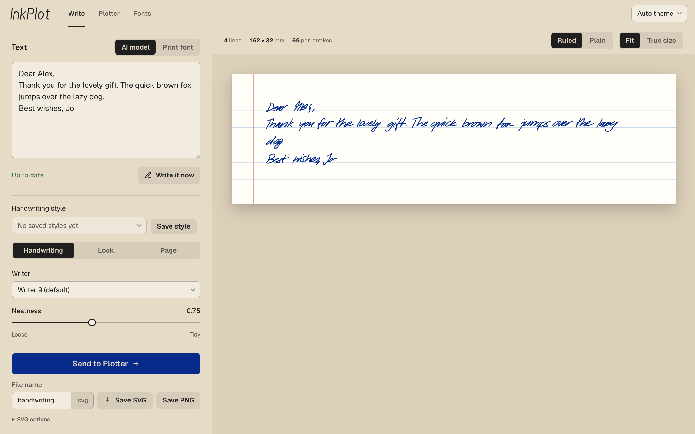
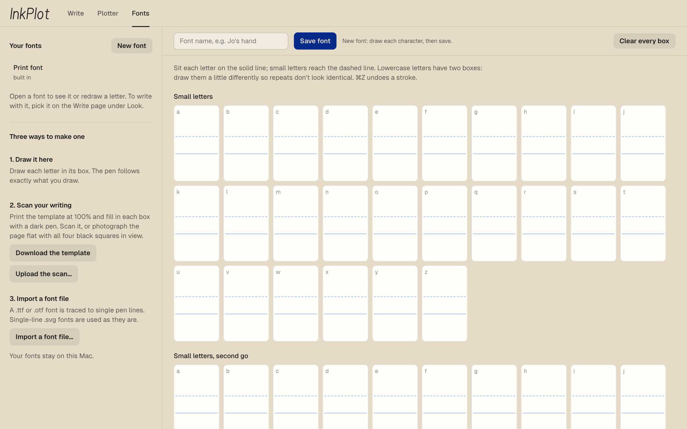

# InkPlot

**Turn a 3D printer into a handwriting machine.** Type a letter and InkPlot writes it out in realistic
handwriting: an AI model, or a font made from your own hand. Lay it out on A4 with line drawings and labels,
then save a print file that has already passed a full set of safety checks.



Built and measured on a **Bambu Lab X1E** with a pen holder clipped to the toolhead; other printers work once
you've measured them. It runs entirely on your Mac; nothing is uploaded anywhere. Made by [It Was Fine In CAD](https://github.com/itwasfineincad).

**[Read the step-by-step guide →](docs/GUIDE.md)**

## What it does

- **Realistic handwriting.** An AI model writes your text in one of 13 hands, with sliders for neatness,
  slant, size, joined-up letters and the odd crossed-out mistake. Each line is written several times and the
  most readable version is kept. Or use a single-line font for instant results.
- **Your own handwriting.** Draw your letters on screen, scan or photograph a filled-in template, or import a
  font file. InkPlot turns it into a single-line font a pen can follow.
- **Lay out a page.** Handwriting, 25 built-in line drawings, your own SVGs, labels, frames, circles and ruled
  lines. Drag, resize and rotate; anything the pen can't reach shows in red.
- **Whole letters.** Long texts flow over as many sheets as they need. The bottom of an A4 sheet is out of
  reach, so it is written in a second part with the sheet turned round, and every print job comes with
  instructions for the paper.
- **Lined paper.** Measure your paper's lines and InkPlot tells you exactly where to put the sheet so the
  writing lands on them.
- **Styles.** Save handwriting settings as styles and mix several hands on one page.
- **Safe files.** Every file is checked before it is saved: no homing, nozzle inside the measured safe area, pen
  on the paper and clear of the magnets. Each file records the pen and printer it was made for, and the check
  refuses it once they change.
- **Plot window.** Pick the pages, rehearse with the pen up, save to the SD card, then follow numbered steps.
- **Any printer.** Printer profiles for Bambu Lab printers and others, with your own measured limits.

| Write | Fonts |
|---|---|
|  |  |

## Quick start

You need a Mac with about 2 GB free, and Python 3.11 (`brew install python@3.11` with [Homebrew](https://brew.sh)).

1. **Download**: click **Code > Download ZIP** on this page and unzip it, or
   `git clone https://github.com/itwasfineincad/inkplot.git`
2. **Install**: double-click **Install InkPlot.command** (5–10 minutes the first time). If macOS says it
   can't be opened, right-click it and choose **Open**.
3. **Start**: double-click **handwriting/My Handwriting.command**. The studio opens in your browser.
4. **Before plotting**: choose your printer and calibrate the pen (**Plotter > Machine**), then click
   **Plot…** and do a **Pen up** run of every new layout first.

The [guide](docs/GUIDE.md) covers each step in detail, plus calibration, whole pages, lined paper, making your
own font and troubleshooting.

> **Safety first.** A wrong move can drive the pen holder into the printer's frame or the magnets. InkPlot
> never homes the printer and checks every file, but its limits were measured on one X1E with one holder.
> On a different setup, measure your own first ([Other printers](docs/GUIDE.md#12-other-printers)).

## Files

```
handwriting/            the studio: server, Write, Plotter and Fonts pages, plotter engine, fonts
handwriting-synthesis/  safety checker, calibration and magnet tools; the AI model is installed here
blueprints/             line drawings to plot, with credits
setup/                  installer and the patch applied to the AI model
docs/                   the guide and its pictures
.claude/skills/         a Claude Code skill that coaches you through making a handwriting font
```

Check any G-code file on its own: `handwriting-synthesis/plotcheck path/to/file.gcode`

## Licence

InkPlot's own code is free for noncommercial use under the [PolyForm Noncommercial License 1.0.0](LICENSE):
use it, change it and share it, but don't sell it. The AI handwriting model, the Geist font and the drawings
keep their own licences; see [THIRD_PARTY.md](THIRD_PARTY.md).
