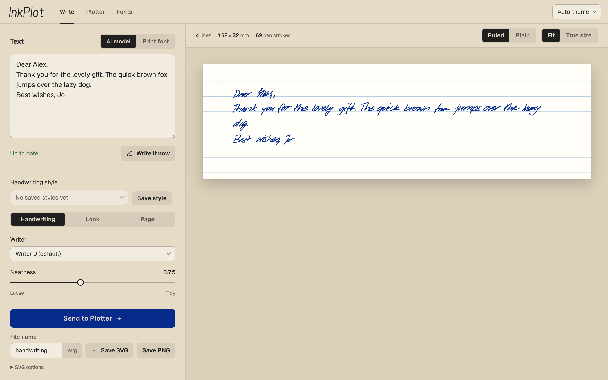
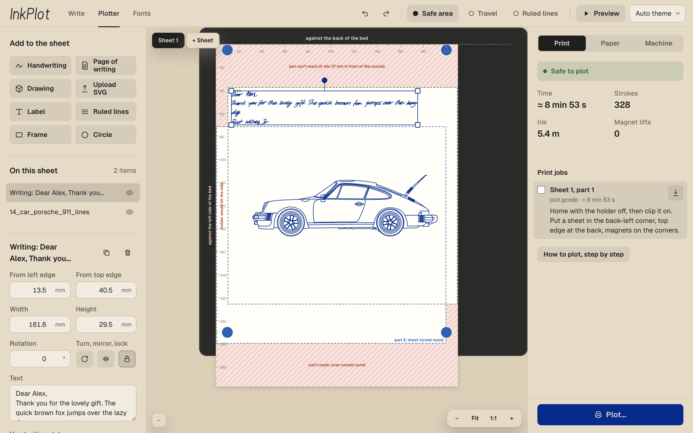
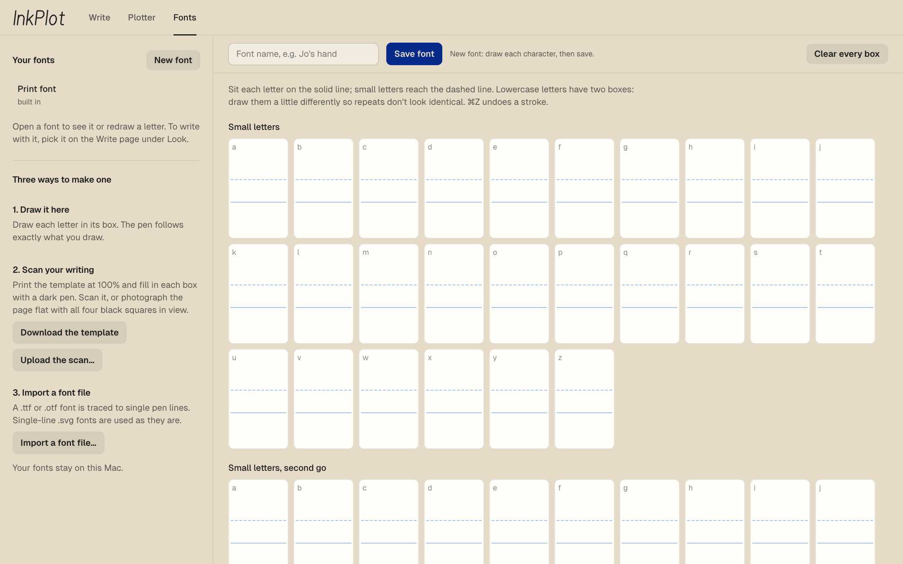

# InkPlot guide

Everything from unboxing to a finished letter, one step at a time. If you only read one section, read
[Safety](#safety): a pen holder on a 3D printer can hit the frame if you skip a step.

**Contents**

1. [What you need](#1-what-you-need)
2. [Install InkPlot](#2-install-inkplot)
3. [Start the studio](#3-start-the-studio)
4. [Set up the printer (once)](#4-set-up-the-printer-once)
5. [Calibrate the pen](#5-calibrate-the-pen)
6. [Your first plot](#6-your-first-plot)
7. [Long letters and whole pages](#7-long-letters-and-whole-pages)
8. [Writing on lined paper](#8-writing-on-lined-paper)
9. [Handwriting styles](#9-handwriting-styles)
10. [Your own handwriting as a font](#10-your-own-handwriting-as-a-font)
11. [Troubleshooting](#11-troubleshooting)
12. [Other printers](#12-other-printers)
13. [Safety](#safety)

---

## 1. What you need

| | |
|---|---|
| **Printer** | A Bambu Lab X1E, or another printer once you've measured it ([Other printers](#12-other-printers)) |
| **Pen holder** | A holder that clips onto the toolhead and holds a pen beside the nozzle. InkPlot was built with the UMTS pen holder. |
| **Pen** | A fine pen or fineliner (0.3–0.5 mm) |
| **Paper** | A4 (210 x 297 mm). Other sizes can be set on the Paper tab. |
| **Magnets** | Four round magnets, about 10 mm across and 5 mm tall, to hold the paper flat |
| **Pad** (optional) | A thin, flat sheet under the paper, e.g. 0.5 mm card, so the pen presses evenly |
| **Mac** | macOS on Apple silicon or Intel, about 2 GB of free disk space |

Plotting doesn't need filament: the printer only moves, the pen does the writing.

## 2. Install InkPlot

**a. Python 3.11.** InkPlot's handwriting model needs exactly Python 3.11.

1. Install [Homebrew](https://brew.sh) if you don't have it: copy the line from its home page into the
   **Terminal** app and press Return.
2. In Terminal, run:

   ```bash
   brew install python@3.11
   ```

**b. Download InkPlot.** On the [InkPlot page](https://github.com/itwasfineincad/inkplot), click the green
**Code** button, then **Download ZIP**. Double-click the ZIP to unzip it and move the folder somewhere permanent,
such as your Documents folder.

Or, if you use git:

```bash
git clone https://github.com/itwasfineincad/inkplot.git
```

**c. Run the installer.** In the InkPlot folder, double-click **Install InkPlot.command**.

> **"Install InkPlot.command" can't be opened** (or "Apple could not verify…")? macOS asks this the first
> time you open anything downloaded that isn't from the App Store. Right-click the file, choose **Open**,
> then **Open** again. On newer macOS: **System Settings > Privacy & Security**, scroll down, and click
> **Open Anyway** next to the file's name. The same applies to **My Handwriting.command** the first time.

A Terminal window opens and shows its progress:

```
== Checking for Python 3.11
== Making the Python environment in ~/.venvs/handwriting-synthesis
== Installing libraries (TensorFlow is large; this can take a few minutes)
== Downloading the handwriting model
== Done
```

It takes 5–10 minutes the first time. Running it again later is safe: it skips what's already done.

## 3. Start the studio

Double-click **handwriting/My Handwriting.command**. A Terminal window opens (leave it open: it *is* the
studio) and your browser opens **http://127.0.0.1:8765**. To stop the studio, close that Terminal window.

The studio has three pages, in the bar at the top:

- **Write**: type text and see it in handwriting.
- **Plotter**: lay out the sheet and save the files the printer runs.
- **Fonts**: make a font from your own handwriting.



**Write page, in short:**

- Type in **Text**. It starts writing by itself.
- **AI model** gives realistic, varied handwriting; the first line takes about 30 seconds while the model loads,
  later lines a few seconds each. **Print font** (or your own font) is instant.
- The **Handwriting** tab picks the writer (13 to choose from) and how neat it is. **Look** sets size, slant and
  spacing. **Page** sets line spacing and width.
- **Send to Plotter** puts the writing on the Plotter's sheet.

## 4. Set up the printer (once)

1. **Choose your printer**: **Plotter > Machine > Printer**. The Bambu Lab X1E is the default.
2. **Turn off the printer's print monitoring** (Bambu: air-printing detection and first layer inspection) in
   the printer's settings. A plot extrudes nothing, so these checks can pause it mid-plot and knock the holder.
   Files for Bambu printers already turn off spaghetti detection themselves.
3. **Never home with the holder on.** Homing sends the head to places the holder can't go. The habit is:
   home from the printer's screen with the holder **off**, move the head to the middle of the bed, then clip
   the holder on.
4. **Paper position**: InkPlot assumes the sheet lies with its **left edge against the left side of the bed**
   and its **top edge against the back of the bed**, with magnets on the corners. The Plotter page shows where
   each magnet goes.

## 5. Calibrate the pen

The pen sits beside the nozzle, so InkPlot needs to know exactly where. Open **Plotter > Machine >
Calibrate…** and follow the four steps. Each step saves a small file to print.

1. **Pen.** Enter how far the pen tip should stick out below the nozzle tip (**10 mm** works well) and the
   thickness of your pad (0 if none). Click **Save pen-height file** and print it with the pen pulled up in
   the holder: the bed rises until the paper is exactly that far below the nozzle, then waits 4 minutes.
   Slide the pen down until it just touches the paper and tighten the holder.
2. **Calibration cross.** Put a sheet in the back-left corner with the magnets on. Click **Save calibration
   cross** and print it (not sure it will clear? print the **Pen-up version** first). The pen draws a small
   cross with a circle.
3. **Measure.** Measure the circle's centre from the paper's **left edge** and from its **top edge**, in mm,
   type both in, and click **Save the offset and a check cross**.
4. **Check.** Print the check cross on a fresh sheet. It should land exactly where the dialog says. If it is
   more than about 1 mm out, measure where it landed, type it in, and click **Correct the offset**.

Calibrate again whenever you re-clip the holder, move the pen in it, change the pad or switch printer. Every
file records the printer, pen, pad and offset it was made for, and the safety check refuses it once any of
those change, so **save your plot files again after recalibrating**.

## 6. Your first plot



1. On the **Write** page, type a short note and click **Send to Plotter**. Or, on the Plotter page, use
   **Add to the sheet > Handwriting**.
2. Add anything else: a **Drawing** from the built-in library (25 rockets, cars and aircraft), your own
   **Upload SVG**, a **Label**, a **Frame**, **Ruled lines**. Drag to move, use the corner handles to resize,
   the round handle to rotate.
3. Anything the pen can't reach is shown in **red stripes**: the top ~37 mm of the sheet (the pen sits in front
   of the nozzle) and a strip along the left edge (the holder would hit the side of the printer).
4. Check the **Print** tab. **Safe to plot** means the file has passed every safety check. It also shows the
   time, the number of strokes and how much ink line will be drawn.
5. Click **Preview** (top right) to watch the pen, nozzle and holder move through the plot.
6. Click **Plot…** (bottom right). In the window:
   1. **Which pages?** Tick the sheets and parts to plot.
   2. **Pen**: **Draw** for the real plot. **First time with a new layout?** Choose **Pen up (rehearsal)**
      first: the same moves with the pen 10 mm above the paper, so you can check nothing hits the frame or a
      magnet.
   3. **Save to**: the printer's **SD card** (put it in your Mac first) or a folder.
7. Click **Save**. The window then shows **How to plot**: eject the card, home with the holder off, clip it
   on, and one step per file saying where the paper goes and which file to print. Tick each as you go.
   **How to plot, step by step** on the Print tab opens it again.

## 7. Long letters and whole pages

The pen can't reach the bottom ~40 mm of an A4 sheet, because the sheet hangs off the front of the bed. So a
full page is written in **two parts**:

- **Part 1**: the sheet as normal.
- **Part 2**: the **same sheet turned round** (still face up, top edge now at the front), so the pen can
  reach what was the bottom. Part 2 strokes are shown in **teal**.

Use **Add to the sheet > Page of writing** for anything longer than a few lines. Paste the text, pick a style,
and choose **Where**:

- **Replace every sheet**: start again from the top of sheet 1.
- **Carry on under the writing on this sheet**: continue below what's already there.
- **Start on new sheets**: add sheets after the current one.

It wraps the text, fills each sheet, splits it into parts and adds more sheets as needed. **Plot…** then
saves every file in order, and **How to plot** says what to do with the paper before each one.

> Don't use **Handwriting** for a long text: anything too big for the reachable area is shrunk to fit, and the
> Selected panel will say "Printed at N% of its real size". Page of writing keeps the writing at full size.

## 8. Writing on lined paper

On the **Paper** tab, switch on **Write on lined paper** and measure your sheet in mm: the first line from the top, the
last line from the bottom, the margin from the left, where the lines end on the right, and the line spacing.

InkPlot then works out where the sheet has to go so the writing lands on the lines. Often that means sliding
the sheet a few mm forward from the back of the bed. The **placement bar** on the canvas and the print job
instructions give the exact distance and where the magnets go. Measure at both ends of the sheet so it sits
square.

## 9. Handwriting styles

A **style** is a saved set of handwriting settings: AI writer, neatness, slant, size, or a font. On the Write
page, set things up the way you like and click **Save style**. Pick it from the **Handwriting style** list
later.

On the Plotter page, every **Handwriting** or **Page of writing** item has its own style. To mix styles on one
sheet, for example a note and a reply in different hands, add them separately and pick a different style for
each. To change a piece of writing later, select it and use **Text**, **Handwriting style** and **Rewrite it**
in the Selected panel. It stays on its ruled line.

## 10. Your own handwriting as a font

A pen plotter needs a **single-line** font: one line down the middle of each stroke. Ordinary fonts, including
handwriting fonts made with Calligraphr or FontCrafter, store the *outline* of each letter, so a plotter
would draw every stroke twice as a hollow double line. The **Fonts** page makes single-line fonts three ways.
All three end up in the same place.



**Draw it on screen** (10 minutes, any mouse, trackpad or drawing tablet)

1. Click **New font** and type a name.
2. Draw each character in its box. Letters **sit on the solid line**; small letters (a, c, e, n, o…) reach
   the **dashed line**; tall letters and capitals go above it; tails (g, j, p, y) go below.
3. Small letters have **two boxes**: draw them slightly differently, and InkPlot mixes the two so repeated
   letters don't look stamped.
4. **⌘Z** undoes a stroke; hover a box and click **×** to clear it. Click **Save font**, then type in
   **Try it** to check.

**Scan a template** (your real pen-on-paper handwriting)

1. Click **Download the template** and print it at **100% / actual size**, not "fit to page".
2. Write each character in its box with a **black or dark blue pen**. Pencil and light colours don't scan.
3. Scan it at 300 dpi, or photograph it flat in even daylight, straight from above, with **all four black
   corner squares** in the picture. PNG, JPG, PDF and iPhone photos all work. On an iPhone, **Notes > Scan
   Documents** flattens the page for you.
4. Click **Upload the scan…** and name the font. It tells you about any empty boxes.

**Import a font file**

- A **.ttf / .otf** made with another tool: **Import a font file…**. The outlines are traced down to their
  centre lines. Bold, even-width fonts work best.
- A **single-line SVG font** (Inkscape's Hershey Text, the Custom Stroke Font extension) is read as it is.

**Using it:** on the Write page switch to font mode (the second button beside **Text**), open **Look** and pick
it under **Font**. If you write upright, set **Slant** to 0. Then **Save style** so it's one click away on the
Plotter page. Labels on the Plotter have their own **Font** list.

Anything you didn't draw is filled in from the built-in print font, and accented letters (é, ü, ø…) are built
from your own letters. Your fonts are saved in `handwriting/fonts/` and **never leave your Mac**: that folder is
excluded from git, so they can't be published by accident.

## 11. Troubleshooting

| What happens | What to do |
|---|---|
| The printer **paused by itself** mid-plot (bed dropped, head moved to a corner) | Its print monitoring stopped it. Turn off air-printing and first layer detection (step 4) and save the files again. Don't resume with the holder on: take the holder off first. |
| **plotcheck says NOT SAFE for this setup** | The file was made for another pen, pad, offset or printer. Save it again from the Plotter. |
| The pen **doesn't touch** the paper, or presses too hard | Redo calibration step 1 (pen height), then save your plot files again. Check the **Pad under the paper** value matches what's really there. |
| Writing lands **in the wrong place** | Redo calibration steps 2–4. Check the sheet is pushed fully into the back-left corner (or placed where the print job says). |
| A **red message** on the Print tab | It says what's wrong, e.g. something in the red area or over a magnet. Move or shrink that item. Files are only saved once the check passes. |
| The printer **can't read the SD card** | Eject it first (**Plot… > Save to > Eject**). **Clean card** next to it removes hidden macOS files the printer may show as junk. |
| The **first AI writing is slow** | Normal: the model loads for about 30 seconds. After that each line takes a few seconds. |
| The page looks **unstyled** after updating InkPlot | Restart the studio: close its Terminal window and double-click **My Handwriting.command** again. |
| **"can't be opened"** when double-clicking a .command file | Right-click it, choose **Open**, then **Open**. Or use System Settings > Privacy & Security > Open Anyway. |
| The installer says **Python 3.11 is needed** | Run `brew install python@3.11` in Terminal, then double-click the installer again. |
| An accent sits on the wrong letter, or the AI writing has a scribble | Click **Shuffle** for a new attempt, or raise **Neatness**. |

To check any G-code file yourself, run this in Terminal from the InkPlot folder:

```bash
handwriting-synthesis/plotcheck path/to/file.gcode
```

## 12. Other printers

Pick your printer under **Plotter > Machine > Printer**. Built in: Bambu Lab X1E (measured), X1 / X1 Carbon
and P1S / P1P (copied from the X1E), A1 and A1 mini (guesses), and **Other printer** as a starting point.
Only the X1E has been measured, so for anything else make your own profile:

1. Click **New profile…**.
2. Enter the **bed size**.
3. Measure **where the nozzle can safely go**: home with the holder off, clip it on, then move the head slowly
   left, then forward, with the printer's own controls, until the holder is 5 mm from touching. Enter the
   position the printer's screen shows.
4. Tick **I measured these on my printer** only if you did.
5. Click **Save and use it**, then calibrate the pen (step 5).

Profiles for Bambu printers turn off spaghetti detection in every file (`M981 S0 P20000`, the line Bambu
Studio itself uses). Other printers never get Bambu commands. Extra start and end G-code may only set things
up: moves, homing, bed levelling and heating are refused.

Then do a **Pen up** and an **Outline** run of everything before plotting for real.

## Safety

- Home with the holder **off**. Never home, resume or stop a print with the holder on.
- Turn off the printer's print monitoring before plotting.
- Print the **Pen up** version of every new layout first, and watch it.
- Recalibrate after moving the pen, and save your plot files again afterwards.
- Only print files saved by InkPlot (or checked with `plotcheck`). Every file InkPlot saves has passed its
  checks: no homing, no arcs, the nozzle inside the safe area, the pen on the paper and clear of the magnets.
- Stay near the printer while it plots.
